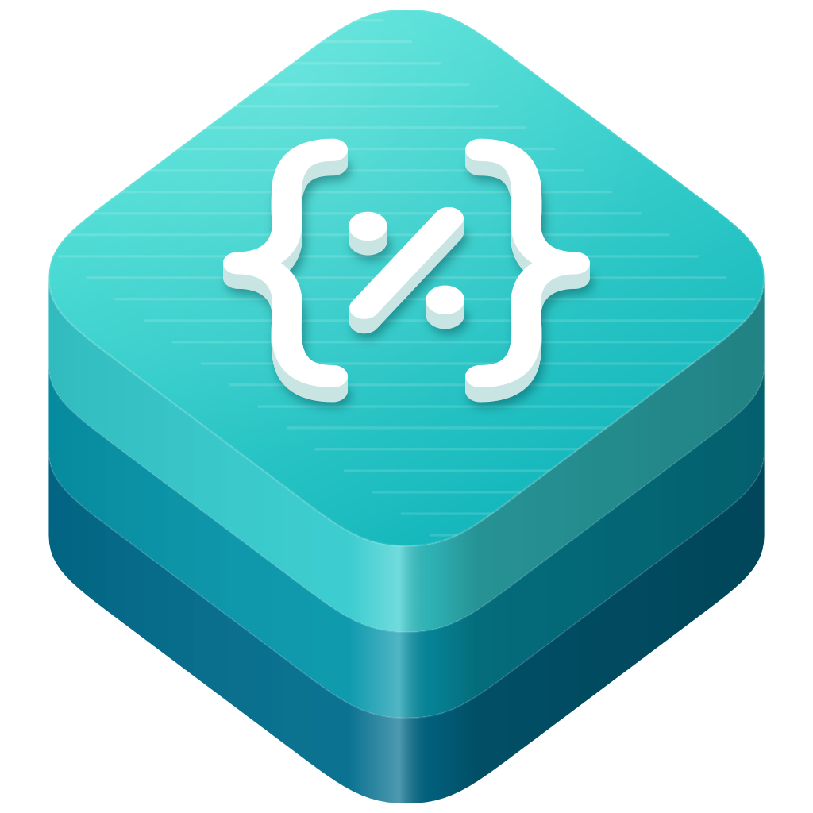

<div align="center">

<p align="center">
  <a href="https://github.com/swift-library/swift-gyb"></a>
</p>

<h1 align="center">swift-gyb</h1>

<p align="center">
  Generate Swift sources and resource files from Python templates during SwiftPM builds.
</p>

<p align="center">
  <a href="https://github.com/swift-library/swift-gyb/actions/workflows/ci.yml"></a>
  
  
  <a href="LICENSE.txt"></a>
</p>

<p align="center">
  <a href="#overview">Overview</a> ·
  <a href="#quick-look">Quick look</a> ·
  <a href="#install">Install</a> ·
  <a href="#usage">Usage</a> ·
  <a href="#requirements">Requirements</a> ·
  <a href="#documentation">Documentation</a> ·
  <a href="#contributing">Contributing</a> ·
  <a href="#license">License</a>
</p>

</div>

## Overview

Keep repeated declarations in a template that expands with the target. `GybPlugin` also bundles generated resources under their own extensions; the [usage guide](Documentation/Reference/Usage.md) covers Python template syntax, build conditions, and output rules.

## Quick look

Place `Setting.swift.gyb` beside the target’s Swift files and enable `GybPlugin`:

```text
public enum Setting {
% for type in ["Bool", "Int", "String"]:
  case ${type.lower()}(${type})
% end
}
```

## Install

Add the package to `Package.swift` and apply `GybPlugin` to each target that
contains templates:

```swift
dependencies: [
  .package(
    url: "https://github.com/swift-library/swift-gyb.git",
    .upToNextMinor(from: "0.2.0")
  ),
],
targets: [
  .target(
    name: "YourLibrary",
    plugins: [
      .plugin(name: "GybPlugin", package: "swift-gyb"),
    ]
  ),
]
```

The plugin works with library, executable, and test targets written in Swift.
It skips targets in other languages.

> [!NOTE]
> swift-gyb is pre-1.0. Minor releases may include breaking changes, so
> depend on it with `.upToNextMinor(from:)`.

## Usage

Apply `GybPlugin` to each target with templates and keep at least one ordinary Swift file in that target. The [usage guide](Documentation/Reference/Usage.md) contains a complete package, generated enum, resource examples, and template syntax.

## Requirements

- Swift 6.3 or later.
- Python 3, available as `python3` on the build machine's `PATH`.
- macOS 15, iOS 18, tvOS 18, or watchOS 11 or later, or Linux.

Apple deployment targets cover the three most recent platform generations.
Availability checking against the latest SDK covers older supported systems.

The shared CI compiler lane builds and tests with the latest stable Xcode,
currently Xcode 26.6 on macOS 26.

## Documentation

- [Usage guide](Documentation/Reference/Usage.md): examples, behavior, and limits.
- [Release reference](Documentation/Reference/Release.md): version declarations and publication.
- [gyb.py](https://github.com/swiftlang/swift/blob/main/utils/gyb.py): the
  template engine in the Swift repository.
- [Swift GYB](https://nshipster.com/swift-gyb/) on NSHipster: a walkthrough of
  gyb templates in the Swift standard library.
- [Changelog](CHANGELOG.md)

## Contributing

Read [CONTRIBUTING.md](CONTRIBUTING.md) and the
[code of conduct](https://github.com/swift-library/.github/blob/master/CODE_OF_CONDUCT.md) before opening a pull request. Run the
[local validation commands](CONTRIBUTING.md#validation) before submitting changes.
The tests use Swift Testing and require Swift 6.3 or later. Releases
follow the swift-library
[versioning standard](https://github.com/swift-library/.github/blob/master/VERSIONING.md).

## License

swift-gyb is available under the Apache License 2.0 with the Swift Runtime
Library Exception. See [LICENSE.txt](LICENSE.txt) and [NOTICE](NOTICE). The
bundled `gyb.artifactbundle/gyb.py` is
[`utils/gyb.py`](https://github.com/swiftlang/swift/blob/2f9445d55e84eec95d3e066299d8f4636a3e5af9/utils/gyb.py)
from the Swift project, which is distributed under the same license.
